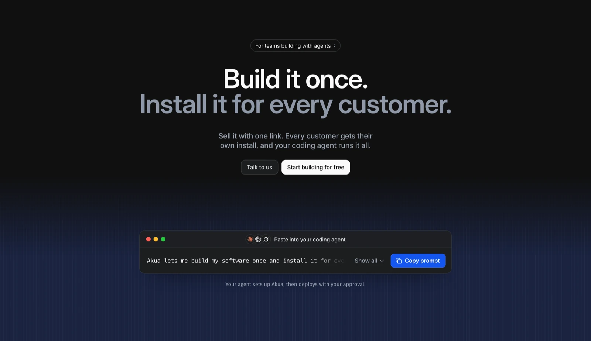
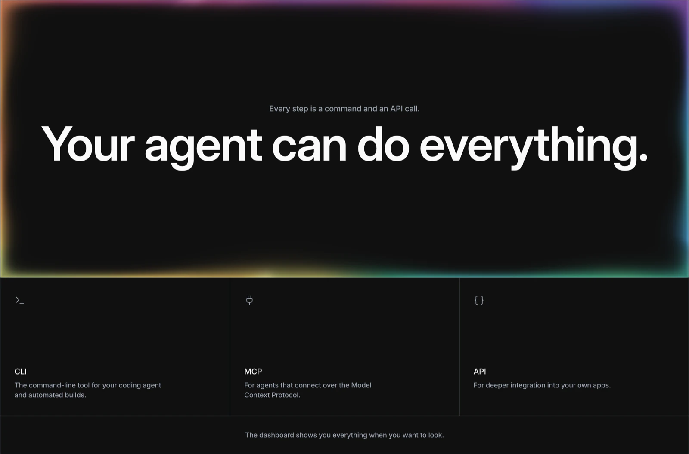

<div align="center">
  <a href="https://akua.dev"></a>

  <h1>Akua</h1>

  <p>Build it once. Install it for every customer.</p>

  <p>
    <a href="https://akua.dev/discord"></a>
    <a href="https://docs.akua.dev"></a>
    <a href="https://akua.dev"></a>
    <a href="./LICENSE"></a>
  </p>
</div>

## Start with your coding agent

Paste this prompt into Claude Code, Codex, Cursor or any agent that can run
terminal commands. It installs the `akua` CLI, signs you in through your
browser and works out with you what to set up:

<!-- generated:quickstart-prompt:start -->
```text
Akua lets me build my software once and install it for every customer, each with their own install, on a server Akua runs or one they own.
Read https://docs.akua.dev/agent-setup/prompt, install the Akua CLI and sign me in with `akua auth login`.
Then work out with me what I want to set up, and ask me before you change anything.
```
<!-- generated:quickstart-prompt:end -->

Prefer the terminal? Install the CLI and sign in:

```sh
brew install akua-dev/tap/akua
akua auth login
```

Homebrew works on macOS and Linux. On Windows, or without Homebrew, use the
[checksummed release archives](packages/cli/docs/install.md).

## What Akua does

Akua runs a separate install of your software for each of your customers, on a
server Akua runs or on a server the customer owns. For example, an agency
builds one booking app and gives each client their own copy, with the client's
own data and web address. You share an app with a customer through one link.

<p align="center">
  
</p>

Every step is a command your agent can run and you can read. The `akua` CLI
covers the whole flow, and the [MCP server](https://docs.akua.dev/ai/platform-mcp)
and the [API](https://docs.akua.dev/apis/introduction) offer the same steps to
other tools. To run it yourself:

```sh
akua workspaces list                # the Workspaces you can use
akua commands --resource clusters   # discover what you can do
akua docs search "deploy an app"    # search the docs from your terminal
```

Next: [deploy an app and get its URL](https://docs.akua.dev/guides/deploy-an-app),
or [share it with a customer](https://docs.akua.dev/guides/share-with-a-customer).

## Why you can trust it

- **Open source.** The [`akua` CLI](packages/cli/) and the
  [akuapkg package format](packages/akuapkg/) live in this repository under
  the [Apache-2.0](LICENSE) license.
- **Your agent asks first.** The setup prompt has your agent look things up
  on its own, and ask you before anything that costs money, connects a server,
  touches production, publishes, shares or deletes. It never asks for or
  prints secrets, and sign-in happens in your own browser.
- **Your servers stay yours.** Apps run on servers you or your customers own,
  or on a server Akua runs for you. On your own servers you pay your provider
  directly; Akua adds no fee and no markup.
- **Packages render in a sandbox.** akuapkg runs Helm, Kustomize and KCL as
  WebAssembly with no access to your files, network or environment, and pins
  every dependency by digest. The [security model](docs/security-model.md)
  lists what it guarantees and what it doesn't.
- **A clear security policy.** Report vulnerabilities privately through
  [GitHub Security Advisories](https://github.com/akua-dev/akua/security/advisories/new)
  or to security@akua.dev ([SECURITY.md](SECURITY.md)). Akua's
  [security page](https://docs.akua.dev/platform/security) says what Akua does
  and what it doesn't have yet, such as certifications.
- **Alpha, said plainly.** The package format, the JSON output, and the error
  and exit codes are stable enough to build on; other interfaces can still
  change.

## Build a typed Kubernetes package

akuapkg is built into `akua` as `akua pkg`, and you don't need an Akua account
to use it:

```sh
akua pkg init hello
cd hello
akua pkg render --inputs inputs.example.yaml
```

A typo in a field, or a value your Kubernetes version doesn't accept, fails the
render with the file and line. To use the format on its own, install
`brew install akua-dev/tap/akuapkg`. Next:
[the akuapkg walkthrough](packages/akuapkg/#quick-start) and the
[package format](https://docs.akua.dev/akua).

## Contributing

Bug reports, reproductions, root-cause analysis and design feedback are
welcome as [issues](https://github.com/akua-dev/akua/issues). Akua is developed
in an internal monorepo that this repository mirrors, so code pull requests
can't be merged here yet; describe the fix in an issue instead.
[CONTRIBUTING.md](CONTRIBUTING.md) explains what helps most, and
[docs/building.md](docs/building.md) how to build and test from a clone. Ask
questions and share what you build on [Discord](https://akua.dev/discord).

---

<div align="center">
  <a href="https://docs.akua.dev/quickstart"></a>

  <p>
    <a href="https://akua.dev">Website</a> ·
    <a href="https://docs.akua.dev">Docs</a> ·
    <a href="https://docs.akua.dev/quickstart">Quickstart</a> ·
    <a href="https://akua.dev/discord">Discord</a>
  </p>
</div>
